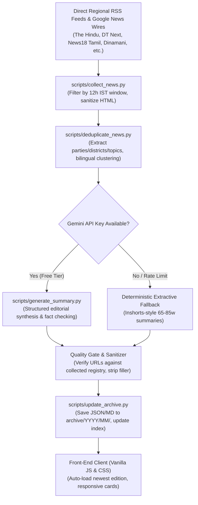

# Tamil Nadu Politics Brief
*"Understand Tamil Nadu Politics. One Briefing at a Time."*

[](https://vishnu-aravind-99.github.io/tamil-nadu-politics-brief/)
[-blue?style=flat-square)](https://github.com/VISHNU-ARAVIND-99/tamil-nadu-politics-brief/actions)
[](LICENSE)
[-success?style=flat-square)](#zero-operating-cost)
[](https://www.python.org/)

**Tamil Nadu Politics Brief** is a fully autonomous, non-partisan digital newspaper and historical research archive covering Tamil Nadu state governance, political parties, assembly proceedings, courts, and district developments. 

Published twice daily at **6:00 AM IST** and **6:00 PM IST**, it condenses complex regional political reporting into high-density, factual, Inshorts-style cards—completely free with zero subscription fees and zero operating costs (`₹0/month`).

🔗 **Live Newspaper:** [https://vishnu-aravind-99.github.io/tamil-nadu-politics-brief/](https://vishnu-aravind-99.github.io/tamil-nadu-politics-brief/)

---

## Table of Contents
- [Key Features](#key-features)
- [Coverage Schedule & Windows](#coverage-schedule--windows)
- [System Architecture](#system-architecture)
- [Project Directory Structure](#project-directory-structure)
- [Setup & Local Development](#setup--local-development)
  - [Prerequisites](#prerequisites)
  - [Installation](#installation)
  - [Running Tests](#running-tests)
  - [Running the Pipeline Locally](#running-the-pipeline-locally)
- [GitHub Deployment & Automation](#github-deployment--automation)
- [Editorial Integrity & Standards](#editorial-integrity--standards)
- [License & Disclaimer](#license--disclaimer)

---

## Key Features

- **Twice-Daily Strict 12-Hour IST Coverage Windows:** Non-overlapping news windows ensure every morning and evening edition captures exclusively what happened during that specific 12-hour block without stale duplication.
- **Multi-Source Publisher Diversity:** Aggregates and cross-checks reporting across direct regional RSS feeds and curated topic searches:
  - *English Outlets:* The Hindu, DT Next, The New Indian Express, The Times of India, Deccan Chronicle, The Indian Express.
  - *Tamil Regional Outlets:* Dinamani, Hindu Tamil Thisai, News18 Tamil Nadu, Polimer News, Oneindia Tamil, BBC Tamil.
- **Cross-Lingual Deduplication & Entity Extraction:** Employs bilingual entity recognition (tracking all 38 Tamil Nadu districts, 12 major political parties, and governance topics) and cross-lingual similarity scoring. Tamil and English articles on the same breaking event automatically merge into a single verified report.
- **Inshorts-Style Reading Experience:** Clean, concise 65–85 word factual summaries. Zero artificial filler sentences, zero repetitive boilerplate, and zero hallucinated links.
- **Smart Front Page & Dynamic Layout:**
  - Auto-detects the newest edition based on news window cutoff (`coverage_end_ist`).
  - At 6:00 PM IST, the **Evening Brief** appears first on the left card and as the primary lead briefing.
  - At 6:00 AM IST, the **Morning Brief** takes precedence.
  - Re-running older historical editions or backfilling never displaces newer editions.
- **Comprehensive Search & Archive:** Filterable by date, political party, topic, district, and edition type. Editions are permanently archived as dual `.json` and readable `.md` files.
- **Zero Operating Cost (`₹0/month`):** Hosted completely on GitHub Pages, automated via GitHub Actions cron workflows, and powered by Gemini 2.5 Flash Free Tier with an extractive fallback.

---

## Coverage Schedule & Windows

Each edition strictly covers a discrete 12-hour Indian Standard Time (IST = UTC+5:30) window:

| Edition | Publication Time | Coverage Window (IST) | Primary Focus |
|---|---|---|---|
| **Morning Brief** | **6:00 AM IST** | Previous Day 6:00 PM &rarr; Today 6:00 AM | Overnight developments, evening press meets, late-breaking legal orders, early morning statements |
| **Evening Brief** | **6:00 PM IST** | Today 6:00 AM &rarr; Today 6:00 PM | Secretariat cabinet decisions, Assembly sessions, afternoon political rallies, court rulings, district events |

---

## System Architecture



---

## Project Directory Structure

```text
tamil-nadu-politics-brief/
├── .github/
│   └── workflows/
│       ├── morning-edition.yml      # Cron: 00:30 UTC (6:00 AM IST)
│       └── evening-edition.yml      # Cron: 12:30 UTC (6:00 PM IST)
├── archive/
│   └── YYYY/MM/                     # Permanent dual-format archive (.json & .md)
│       ├── 2026-11-01-morning.json
│       ├── 2026-11-01-morning.md
│       ├── 2026-11-01-evening.json
│       └── 2026-11-01-evening.md
├── assets/
│   ├── css/
│   │   └── style.css                # Newspaper typography, dark/light theme, 360px mobile responsive
│   └── js/
│       └── app.js                   # Client-side router, Inshorts card renderer, archive filter
├── data/
│   ├── archive-index.json           # Reverse chronological index of all historical editions
│   ├── latest-editions.json         # Current morning & evening edition cards
│   ├── pipeline-logs.json           # Execution metrics (raw items, clusters, duration, provider)
│   └── sources.json                 # Curated registry of RSS feeds and regional search queries
├── scripts/
│   ├── config.py                    # Constants, 38 districts, 12 parties, 12h IST window calculators
│   ├── collect_news.py              # Multithreaded RSS fetcher & timestamp normalizer
│   ├── deduplicate_news.py          # Cross-lingual Jaccard clustering & entity extraction
│   ├── generate_summary.py          # Gemini AI prompt engine & extractive summarizer
│   ├── update_archive.py            # Chronological indexer & Markdown twin generator
│   └── publish_edition.py           # Master CLI runner orchestrating all pipeline stages
├── tests/
│   └── test_pipeline.py             # 8 unit tests verifying windows, deduplication, URL safety, keys
├── index.html                       # Front page displaying newest edition and latest brief cards
├── edition.html                     # Dedicated permalink view for full individual editions
├── archive.html                     # Searchable historical archive with multi-attribute filters
├── search.html                      # Keyword and topic full-text search
├── about.html                       # Editorial principles, methodology, and source transparency
├── requirements.txt                 # Python dependencies
└── README.md
```

---

## Setup & Local Development

### Prerequisites
- Python 3.10 or newer
- Git

### Installation
1. **Clone the repository:**
   ```bash
   git clone https://github.com/VISHNU-ARAVIND-99/tamil-nadu-politics-brief.git
   cd tamil-nadu-politics-brief
   ```

2. **Set up a virtual environment:**
   ```bash
   python -m venv venv
   # On macOS/Linux:
   source venv/bin/activate
   # On Windows:
   venv\Scripts\activate
   ```

3. **Install dependencies:**
   ```bash
   pip install -r requirements.txt
   ```

4. **(Optional) Configure Gemini API:**
   ```bash
   cp .env.example .env
   ```
   Add your free `GEMINI_API_KEY` from [Google AI Studio](https://aistudio.google.com/).  
   *(If omitted, the pipeline automatically runs with the built-in deterministic extractive engine at ₹0 cost).*

### Running Tests
Execute the unit test suite to verify window calculations, timestamp normalization, cross-lingual clustering, and index safety:
```bash
python -m unittest discover -s tests -v
```

### Running the Pipeline Locally

Generate the **Morning Edition** for today:
```bash
python -m scripts.publish_edition --edition morning
```

Generate the **Evening Edition** for today:
```bash
python -m scripts.publish_edition --edition evening
```

Generate a historical edition for a specific date (Backfill):
```bash
python -m scripts.publish_edition --edition evening --date 2026-10-31
```

Force overwrite an existing edition:
```bash
python -m scripts.publish_edition --edition morning --date 2026-11-01 --force
```

Preview locally:
```bash
python -m http.server 8000
# Open http://localhost:8000 in your browser
```

---

## GitHub Deployment & Automation

### Enable GitHub Pages
1. Go to repository **Settings** &rarr; **Pages**.
2. Under **Build and deployment** &gt; **Source**, select **Deploy from a branch**.
3. Choose branch: `main`, folder: `/ (root)`.
4. Click **Save**.

### Configure GitHub Actions
1. **Repository Secret (Optional):**
   - Go to **Settings** &rarr; **Secrets and variables** &rarr; **Actions**.
   - Add Secret: `GEMINI_API_KEY` (Free tier key from Google AI Studio).
2. **Workflow Permissions (Required):**
   - Go to **Settings** &rarr; **Actions** &rarr; **General** &rarr; **Workflow permissions**.
   - Select **Read and write permissions** (allows GitHub Actions to commit and publish new editions directly to `main`).

---

## Editorial Integrity & Standards

- **Proportional Political Balance:** Balanced coverage across DMK, AIADMK, BJP, INC, TVK, PMK, NTK, VCK, MDMK, DMDK, AMMK, and Left parties.
- **Primary Source Attribution:** Adheres strictly to fair-use summaries. Every story card includes clickable links back to original publications (*The Hindu*, *Dinamani*, *News18*, *DT Next*, etc.).
- **Zero Hallucinated Links:** All generated output passes through a programmatic verification gate; any URL not present in the ingested RSS batch is rejected.
- **Prompt Injection Defense:** Ingested headlines and snippets are strictly treated as untrusted text, preventing prompt injection or payload execution.
- **Fail-Safe Publishing:** The deterministic extractive fallback ensures editions publish on time even during API network downtime or rate-limit events.

---

## License & Disclaimer

- **Code & Pipeline:** Released under the [MIT License](LICENSE).
- **News Content:** All aggregated headlines, excerpts, and source citations remain the intellectual property of their respective publishers. The project operates strictly as a neutral, non-commercial, automated press review under fair-use principles.
